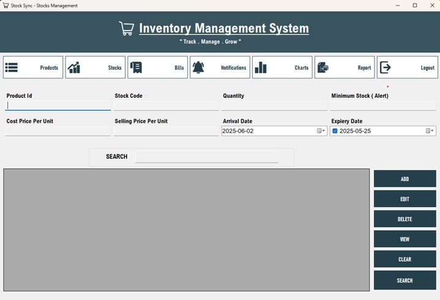
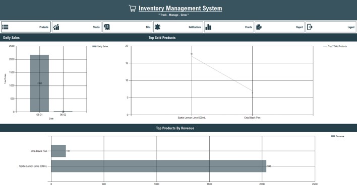

# Stock-Sync — Supermarket Inventory & POS Management System

[](https://dotnet.microsoft.com/)
[](https://learn.microsoft.com/dotnet/csharp/)
[](https://www.microsoft.com/sql-server)
[](https://learn.microsoft.com/dotnet/desktop/winforms/)
[](https://github.com/Ruhama27/Supermarket_inventory_system)

A modern, production-grade Supermarket Inventory Management and Point-of-Sale (POS) desktop application built with **C# Windows Forms** and **Microsoft SQL Server**. 

Stock-Sync streamlines retail operations by combining barcode scanning, multi-batch FIFO inventory tracking, real-time analytics, thermal receipt generation, and **bilingual English & Amharic (አማርኛ)** localization inside a clean, modern SaaS dashboard.

---

## 📸 Interface Preview

| Login Screen | Products Management |
| :---: | :---: |
|  |  |

| Sales Analytics | Class Architecture Diagram |
| :---: | :---: |
|  |  |

---

## ✨ Key Features & Improvements

### 🎨 Modern Store Management & POS Dashboard UI
- **Single-Window Application Shell**: Eliminates scattered popup windows in favor of a cohesive, modern layout inspired by cloud SaaS and modern POS systems.
- **Pure White Sidebar (`#FFFFFF`)**: Clean, minimalist navigation with vibrant Coral-Orange (`#FF5B26`) rounded active pills, section groupings (`MENU`, `OTHERS`), and bottom user profile card (`Admin / Staff`).
- **Signature KPI Summary Strip**: Prominent top summary strip featuring a solid coral card (`Total Orders / Today's Sales`) alongside crisp metric cards (`Occupied / Today's Invoices`, `Reserved / Active Products`, `Available / Low Stock`).
- **Status Badges & Pills**: Modern rounded status badges (`Available / Completed` in soft mint `#E6F7ED`, `Occupied / Low Stock` in soft peach `#FFF0EB`, `Reserved / Pending` in soft lavender `#EEF2FF`).
- **Warm Orange Login Screen (`#FF7518`)**: Warm ambient backdrop with 3D-style depth spheres, centered elevated white card container, and pill action buttons.
- **Ethiopian Birr Currency Formatting**: Financial figures formatted dynamically in Birr (`ETB 126.00` in English, `126.00 ብር` in Amharic).
- **7 Integrated Views**:
  1. **Orders Screen**: Complete invoice history with status badges (`Completed`, `Pending`, `Cancelled`), date range picker, search filter, and pagination footer.
  2. **Point of Sale (POS)**: Real-time barcode scanning, dynamic cart grid, subtotal/tax calculation, cash received/change due calculator, and thermal receipt generation.
  3. **Products Catalog**: Full CRUD operations with soft-delete deactivation and real-time search.
  4. **Stock Batches**: Multi-batch inventory tracking with batch codes, cost price, selling price, arrival dates, and expiry date warnings.
  5. **Dashboard Analytics**: Executive overview with real-time KPI cards (Today's Sales, Today's Invoices, Active Products, Low Stock Alerts) and interactive column/bar charts.
  6. **Daily Sales Reports**: Instant date-filtered reporting with export capabilities.
  7. **System Alerts**: Live monitoring for low stock items, expired batches, and never-sold inventory.

### 🌐 Bilingual Language Support (English & አማርኛ)
- **One-Click Language Switcher**: Toggle dynamically between **English** and **Amharic (አማርኛ)** using the `🌐 አማርኛ` / `🌐 English` button in the top header.
- **Zero-Restart Live Translation**: Instantly re-renders navigation, screen titles, breadcrumb paths, card headers, form labels, dialog messages, and DataGridView table headers without restarting the application.
- **Full Ge'ez Ethiopic Script Coverage**: Native Ethiopic Unicode characters for natural, accessible operation in retail stores and supermarkets in Ethiopia.

### 🔒 Enterprise-Grade Security
- **Targeted PBKDF2 Password Hashing**: Implements industry-standard `Rfc2898DeriveBytes` with **10,000 iterations**, a **128-bit cryptographic salt**, and a **256-bit derived key** specifically for passwords. Usernames remain standard unhashed plain text (`admin`, `staff`) for clean auditing, while user passwords are cryptographically secured.
- **Constant-Time Comparison**: Protects authentication against timing attack vulnerabilities.
- **Transparent Migration**: Seamlessly upgrades legacy plaintext user passwords to salted PBKDF2 hashes on successful login.
- **Role-Based Access Control (RBAC)**: Distinguishes between **Admin** (complete system authority) and **Staff Cashier** (POS, sales, and catalog views).

### 📦 Multi-Batch FIFO/FEFO Stock Tracking
- **Multi-Batch Deduction**: Sales automatically deplete stock across multiple batches using First-In-First-Out (FIFO) or First-Expired-First-Out (FEFO).
- **Concurrency & Transaction Safety**: Utilizes database transactions with `WITH (UPDLOCK, ROWLOCK)` hints to eliminate race conditions and negative inventory discrepancies under heavy retail checkout traffic.
- **Soft Delete Support**: `IsActive` flag ensures discontinued products maintain referential integrity with historical invoices and receipts.

### 📊 Export & Audit Infrastructure
- **One-Click CSV Export**: Easily export Order History, Products Catalog, Stock Batches, and Daily Sales to CSV spreadsheets.
- **Application File Logger**: Tracks startup events, authentications, stock deductions, and runtime warnings to `logs/stock_sync.log`.
- **Database Audit Triggers**: SQL Server triggers automatically record changes to `Products` and `Stocks` into an immutable `AuditLog` table.

---

## 🏗️ System Architecture

```
Stock_Sync Solution
├── App.config                     # Centralized connection strings & settings
├── Program.cs                     # Global exception handling & application entry point
├── DBHelper.cs                    # Centralized ADO.NET connection manager
├── LocalizationManager.cs         # English & Amharic translation dictionaries & event bus
├── UITheme.cs                     # Centralized color palettes, fonts, and data grid styling
├── SecurityHelper.cs              # PBKDF2 salt/hash security module
├── Logger.cs                      # File-based logging utility (logs/stock_sync.log)
├── CsvExportHelper.cs             # Generic CSV exporter for DataTables & DataGridViews
│
├── Models & Business Logic
│   ├── Session.cs                 # Static session context (User ID, Email, Role)
│   ├── Login.cs                   # Authentication with auto-hashing migration
│   ├── Product.cs                 # Product management & search logic
│   ├── Stock.cs                   # Stock batch operations & threshold checks
│   ├── Bill.cs / BillItem.cs      # Multi-batch FIFO checkout & order persistence
│   ├── Report.cs                  # KPI aggregations & date-filtered sales data
│   ├── Chart.cs                   # Analytics charting data providers
│   └── Notification.cs            # Low stock, expired, and dead stock queries
│
└── User Interface
    ├── LoginForm.cs               # Bilingual login form with role routing
    └── MainDashboardForm.cs       # Modern unified shell hosting all 7 sub-views
```

---

## 🗄️ Database Design

**Database Engine**: Microsoft SQL Server (`.\SQLEXPRESS`)

### Core Tables & Views
| Entity | Description |
|---|---|
| `Users` | User credentials, roles (`Admin` / `Staff`), and PBKDF2 password hashes |
| `Products` | Master product catalog, barcodes, categories, and `IsActive` soft-delete flag |
| `Stocks` | Batch inventory, quantities, minimum thresholds, cost/selling prices, arrival & expiry dates |
| `Orders` | Invoices with subtotal, tax, discount, cash received, change due, and cashier reference |
| `OrderDetails` | Line-item details mapping orders to products and quantities |
| `AuditLog` | Automated trigger-based log tracking product and stock modifications |
| `Stock` *(View)* | Aggregated view joining `Products` and `Stocks` for quick catalog inspection |

---

## 🚀 Getting Started

### Prerequisites
- **Operating System**: Windows 10 or Windows 11
- **.NET Framework**: Version 4.7.2 or higher
- **Database**: Microsoft SQL Server (LocalDB, Express, or Standard)
- **IDE** *(optional for development)*: Visual Studio 2022 / 2019 with *.NET desktop development* workload

---

### Installation & Setup

#### 1. Clone the Repository
```bash
git clone https://github.com/Ruhama27/Supermarket_inventory_system.git
cd Supermarket_inventory_system
```

#### 2. Initialize the Database
Open **SQL Server Management Studio (SSMS)** or SQLCMD and run the database setup script against your SQL Server instance:
- Execute [`setup_database.sql`](setup_database.sql) — Creates `InventoryDB`, tables, triggers, stored procedures, and pre-seeded sample data.
- *(If updating an existing database, run [`upgrade_database.sql`](upgrade_database.sql) to add the latest columns and constraints).*

#### 3. Configure Connection String
Verify your SQL Server instance name in [`Stock_Sync/Stock_Sync/App.config`](Stock_Sync/Stock_Sync/App.config):
```xml
<connectionStrings>
    <add name="InventoryDB" 
         connectionString="Data Source=.\SQLEXPRESS;Initial Catalog=InventoryDB;Integrated Security=True;TrustServerCertificate=True" 
         providerName="System.Data.SqlClient" />
</connectionStrings>
```

#### 4. Build and Run
- **Option A (One-Click Launcher)**: Double-click [`Run-StockSync.bat`](Run-StockSync.bat).
- **Option B (Visual Studio)**: Open `Stock_Sync/Stock_Sync.sln`, press `F5` or `Ctrl+F5` to build and run.
- **Option C (CLI)**:
  ```powershell
  msbuild Stock_Sync\Stock_Sync.sln /p:Configuration=Release
  .\Stock_Sync\Stock_Sync\bin\Release\Stock_Sync.exe
  ```

---

## 🚀 Deployment

For complete instructions on deploying Stock-Sync across single computers, multi-terminal cashier LAN networks, or cloud database servers, see our **[Deployment Guide](DEPLOYMENT_GUIDE.md)**:
- **Portable Distribution**: Run `.\package_release.ps1` to produce a standalone ZIP archive.
- **Windows Installer (`Setup.exe`)**: Compile [`installer_script.iss`](installer_script.iss) using [Inno Setup](https://jrsoftware.org/isdl.php).
- **Multi-Terminal LAN POS**: Configure central SQL Server with TCP/IP port 1433 and connect multiple cashier terminals.

---

## 🔑 Default Login Credentials

| Role | Username | Email | Password | Access Level |
|---|---|---|---|---|
| **Admin** | `admin` | `admin@gmail.com` | `admin123` | Full access (Products, Stock, Orders, Reports, Analytics, Alerts) |
| **Staff** | `staff` | `staff@gmail.com` | `staff123` | Operational access (POS Checkout, Cart, Products, Orders) |

---

## 📄 License
This project is open-source and available under the standard MIT License. Feel free to use, modify, and distribute it for personal, academic, or commercial inventory systems.
