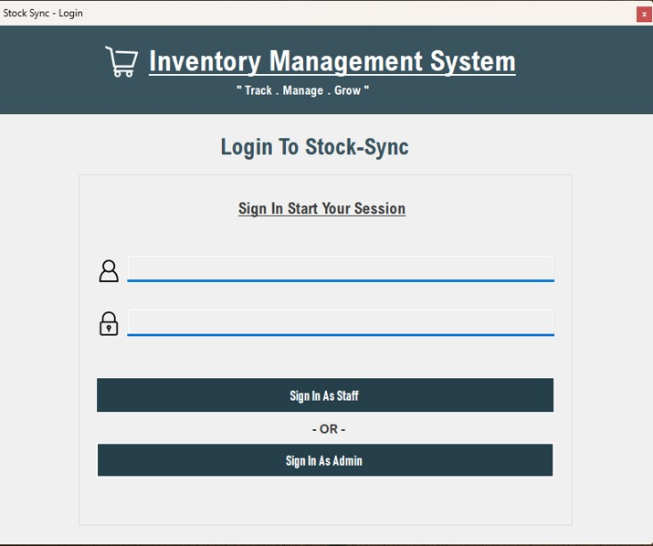

# Stock-Sync — Inventory Management System (Desktop Application)

A desktop-based inventory and billing system built for small and medium retail shops, developed with C# Windows Forms and Microsoft SQL Server. Stock-Sync replaces manual registers and spreadsheets with a structured, database-driven workflow — covering product management, barcode-based billing, automatic stock updates, and real-time alerts for low stock and expired items.

The project was inspired by **Barcode to PC**, a mobile barcode-scanning app that sends scanned barcode data directly to a connected computer — integrated here to make product entry and billing fast during checkout.

## Class Diagram

The diagram below outlines the application's class structure — including the `IDataOperations` interface implemented by core model classes, and how the Product, Stock, Bill, and other entities relate to one another.


## Preview




## Key Features

- Barcode scanning via the Barcode to PC mobile app for fast product entry
- Full product and stock management — add, update, delete, and search records
- Billing system with cart handling, subtotal calculation, cash received, and change returned
- Automatic stock deduction after every completed sale
- Real-time alerts for low stock, expired products, and never-sold items
- Visual sales analytics with charts for daily sales and top-performing products
- Role-based access control separating Admin and Staff permissions
- Search and filter tools across products, stock, and sales records
- Audit logging that automatically tracks product and stock changes

## User Roles

- **Admin** — Full system control: manages products, users, reports, alerts, and all database-related activity
- **Staff** — Restricted to daily shop operations: managing products and creating bills, with access limited to sales-related screens

## System Architecture

Stock-Sync follows a client-database model. The Windows Forms application acts as the client, sending requests whenever a user searches a product, saves a sale, updates stock, or logs in. SQL Server processes each request and returns the result to the client — the same client-to-database-and-back flow is used for every insert, update, delete, and fetch operation across the app.

**Example flow:** scanning a barcode sends the barcode value to SQL Server, which looks up the matching product and returns its name, price, and current stock to the billing screen.

## Database Design

**Database:** Microsoft SQL Server, chosen for its reliability, strong support for structured relational data, and smooth integration with C# via `System.Data.SqlClient`.

**Core Tables:**

| Table | Purpose |
|---|---|
| `Users` | Login credentials and role assignment (Admin / Staff) |
| `Products` | Product name, barcode, category, and status |
| `Stocks` | Quantity, minimum stock threshold, cost/sale price, arrival and expiry dates |
| `Orders` | Bill-level data — date, subtotal, total payable, cash received, change returned |
| `OrderDetails` | Line-item details for each bill |
| `AuditLog` | Automatically logged messages and timestamps for product/stock changes |

**Database concepts applied:**
- `SELECT`, `INSERT`, `UPDATE`, `DELETE` for core record management
- `INNER JOIN` to combine related data across tables
- `GROUP BY` and `ORDER BY` for sales and stock reporting
- Aggregate functions — `SUM`, `COUNT`, `AVG`, `MAX`, `MIN` — for reports and charts
- `LIKE` for partial-text search across products and users
- Subqueries used in the billing and notification modules
- **Triggers** (`trg_Products_Audit`, `trg_Stocks_Audit`) — automatically log insert/update/delete activity on Products and Stocks
- **Stored procedures** (`sp_GetLowStockProducts`, `sp_GetExpiredProducts`, `sp_GetNeverSoldItems`, `sp_GetRecentAuditLogs`) — encapsulate recurring queries for alerts and reporting

## Built With

<p>
  
  
</p>

- **C#** — Application logic and object-oriented design
- **Windows Forms (.NET)** — Desktop user interface
- **Microsoft SQL Server** — Relational database, triggers, and stored procedures
- **System.Data.SqlClient** — Database connectivity layer
- **Visual Studio** — Development environment
- **Barcode to PC** — Mobile barcode scanning integration

## Project Structure

```
Inventory-Management-System-Desktop-Application/
├── SQLQueryForProj.sql          # Full database schema, triggers, and stored procedures
├── Stock_Sync/
│   ├── Stock_Sync.sln            # Visual Studio solution file
│   └── Stock_Sync/
│       ├── IDataOperations.cs       # Core interface defining Add / Update / Delete / Fetch operations
│       ├── DBHelper.cs               # Centralized SQL Server connection handler
│       ├── Session.cs                # Static session state (logged-in email and role)
│       ├── Product.cs                # Product model, implements IDataOperations
│       ├── Stock.cs                  # Stock model and stock-level logic
│       ├── Bill.cs / BillItem.cs     # Billing logic and cart line items
│       ├── Notification.cs           # Low stock / expired / never-sold alert logic
│       ├── Report.cs                 # Sales report data logic
│       ├── Chart.cs                  # Sales analytics and chart data
│       ├── Login.cs                  # Authentication logic
│       ├── LoginForm.cs              # Login & role selection screen
│       ├── ProductsForm.cs           # Product management screen
│       ├── StockForm.cs              # Stock management screen
│       ├── BillForm.cs               # Billing and invoice screen
│       ├── NotificationForm.cs       # Alerts screen
│       ├── ChartsFormcs.cs           # Sales charts screen
│       ├── ReportForm.cs             # Sales reports screen
│       └── Program.cs                # Application entry point
├── class diagram.jpg             # UML class diagram
├── graph.jpg                     # Sales analytics screenshot
├── login.jpg                     # Login screen screenshot
└── products.jpg                  # Product management screenshot
```

## Getting Started

Clone the repository:

```bash
git clone https://github.com/AbdulRehman2345/Inventory-Management-System-Desktop-Application.git
```

1. Open `Stock_Sync/Stock_Sync.sln` in Visual Studio
2. Run `SQLQueryForProj.sql` against a local SQL Server instance to create the `InventoryDB` database, tables, triggers, and stored procedures
3. Update the connection string in `DBHelper.cs` to match your SQL Server instance name
4. Build and run the application


## Author

**Abdul Rehman** — Software Engineer

[LinkedIn](https://www.linkedin.com/in/abdul-rehman-750208312)

## License

This project is open source and available for reference. Feel free to explore the code.
